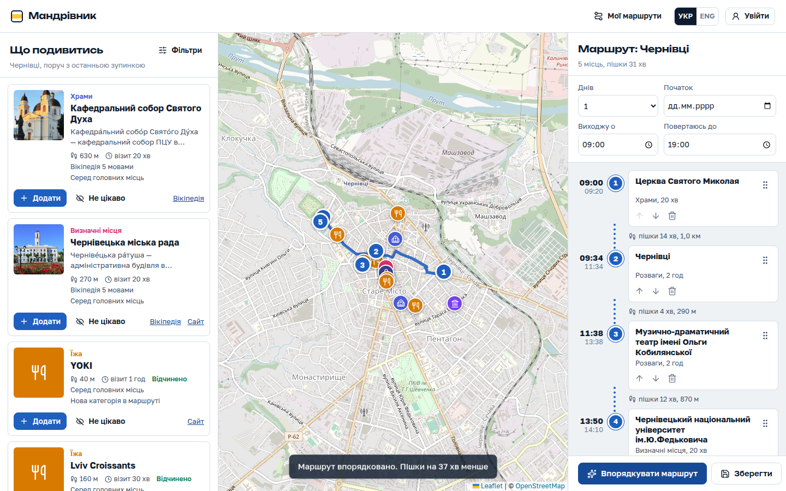

# Мандрівник

Вебсистема для планування пішохідних туристичних маршрутів на відкритих даних. Користувач обирає місто і місця, а система пропонує, що подивитися, знаходить найкоротший порядок зупинок, складає розклад на один або кілька днів і попереджає про конфлікти з годинами роботи.

Система використовує лише відкриті джерела: OpenStreetMap, Wikidata, Вікіпедію та OSRM. Платні ключі доступу не потрібні.



## Можливості

- Пропозиції місць для будь-якого міста з поясненням, чому показано саме їх.
- Оцінка значущості місця навченою моделлю (LightGBM), перевіреною на містах, яких вона не бачила.
- Різноманітні сторінки пропозицій (xQuAD) з урахуванням уподобань і вже обраних зупинок.
- Найкоротший порядок зупинок за реальним часом ходьби вулицями.
- Розклад на кілька днів з урахуванням годин роботи.
- Збереження маршрутів без реєстрації та в обліковому записі, поширення за посиланням.
- Українська та англійська мови, робота на телефоні.
- Працездатність під час відмови зовнішніх сервісів: дані міст зберігаються локально.

## Швидкий запуск

Потрібні Docker і Docker Compose.

```bash
cp .env.example .env          # задайте PLANNER_SECRET_KEY
docker compose --profile app up --build
```

Система відкриється на `http://localhost:8088` (порт задає `APP_PORT`), документація API – на `/docs`.

Дані міста завантажуються з Overpass API під час першого звернення. Щоб не залежати від публічного сервера, місто можна імпортувати з вивантаження [Geofabrik](https://download.geofabrik.de/):

```bash
cd backend
uv run planner-import --pbf ukraine-latest.osm.pbf --place "Чернівці" 48.2921 25.9358
```

## Розробка

```bash
docker compose up -d db                      # PostgreSQL + PostGIS на порту 5544

cd backend
uv sync
uv run alembic upgrade head
uv run uvicorn planner.service.main:app --port 8010

cd ../frontend
pnpm install
pnpm dev                                     # http://localhost:5173, запити йдуть на :8010
```

Перевірки:

```bash
cd backend && uv run ruff check src tests && uv run pytest     # 100 тестів, потрібна запущена база даних
cd frontend && pnpm typecheck && pnpm test                     # 18 модульних тестів
cd frontend && pnpm e2e                                        # 3 наскрізні сценарії, потрібен запущений стек
```

## Будова репозиторію

| Шлях | Вміст |
|---|---|
| `backend/src/planner/` | ядро алгоритмів: таксономія, ознаки, модель значущості, диверсифікація, маршрутизація |
| `backend/src/planner/service/` | вебсервіс: API, сценарії рекомендацій і планування, провайдери зовнішніх сервісів |
| `backend/src/planner/experiments/` | експерименти Е1–Е4 і навантажувальний тест |
| `backend/experiments/` | результати експериментів (`results/`), рисунки (`figures/`) |
| `backend/tests/` | модульні та інтеграційні тести |
| `frontend/` | клієнтський застосунок (React, TypeScript) |
| `docs/screenshots/` | знімки екрана, які створює наскрізний тест |

Ядро алгоритмів є спільним для вебсервісу й експериментів: у системі працює той самий код, якість якого виміряно.

## Експерименти

Дані для експериментів (траєкторії Flickr, вивантаження OSM, дампи Wikidata і статистики переглядів Вікіпедії) зберігаються поза репозиторієм у каталозі `PLANNER_DATA_ROOT`. Конвеєр запускається по кроках:

```bash
cd backend
uv run python -m planner.experiments.build_extracts     # об'єкти OSM для міст
uv run python -m planner.experiments.match              # зіставлення місць Flickr з OSM
uv run python -m planner.experiments.wiki_signals       # sitelinks і перегляди
uv run python -m planner.experiments.dataset            # таблиці кандидатів з ознаками
uv run python -m planner.experiments.e1_popularity      # Е1: перевірка ручної оцінки
uv run python -m planner.experiments.e2_classifier      # Е2: модель значущості
uv run python -m planner.experiments.e3_recommendation  # Е3: якість рекомендацій
uv run python -m planner.experiments.train_final        # модель для сервісу
uv run python -m planner.experiments.matrices           # матриці часу ходьби
uv run python -m planner.experiments.e4_ordering        # Е4: порядок зупинок
uv run python -m planner.experiments.e4_toptw           # Е4: багатоденний розклад
uv run python -m planner.experiments.figures            # рисунки
uv run python experiments/digest.py > experiments/results/digest.txt
```

Усі експерименти детерміновані. Зведення результатів – у `backend/experiments/results/digest.txt`.

## Джерела даних і ліцензії

Дані про місця © учасники OpenStreetMap (ODbL). Описи та зображення – з Вікіпедії та Wikidata. Маршрути – OSRM. Еталонні траєкторії туристів – набори К. Ліма зі співавторами на основі YFCC100M.

Публічні сервери Overpass і OSRM мають обмеження на частоту запитів. Для постійної експлуатації варто розгорнути власні екземпляри й указати їхні адреси у змінних `PLANNER_OVERPASS_URLS` та `PLANNER_OSRM_URL`.
